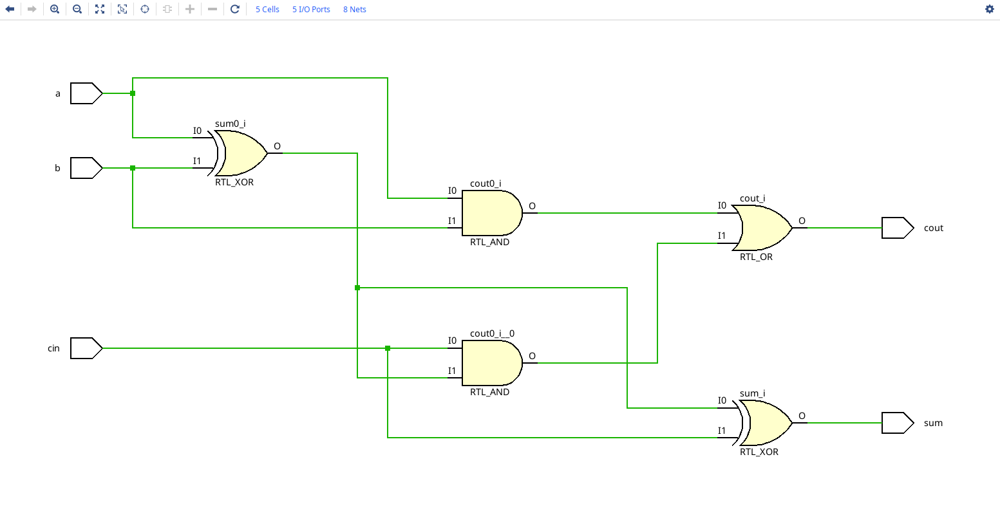
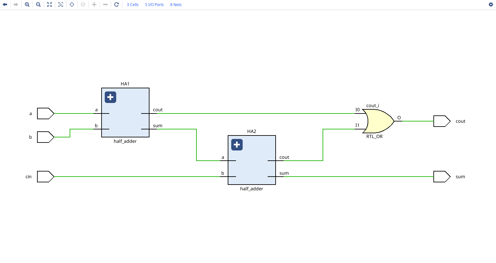
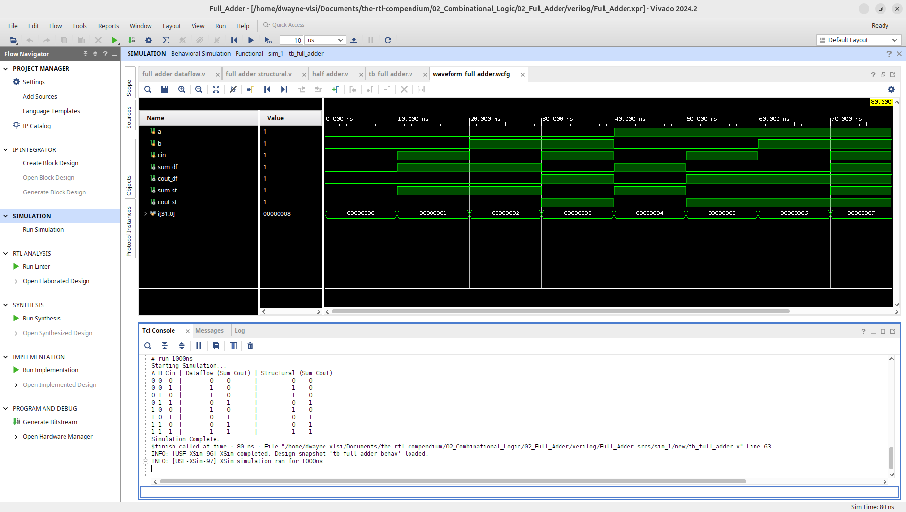
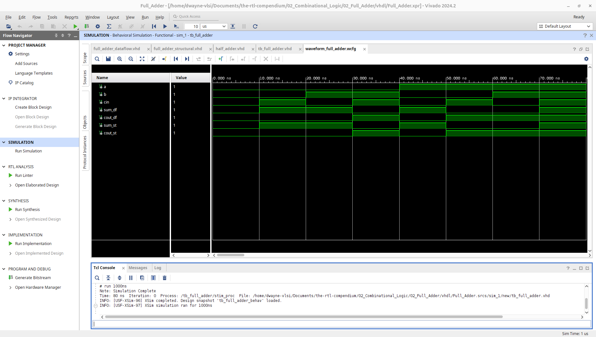
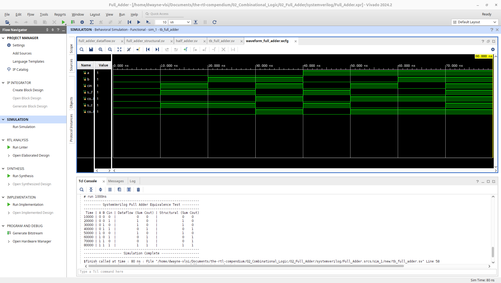

# Full Adder Arithmetic Circuit

This module implements a 1-bit Full Adder, a core combinational logic circuit that computes the sum of three binary bits. To demonstrate architectural versatility, this design has been implemented using two distinct modeling techniques: **Dataflow** and **Structural**. Both designs have been verified for logical equivalence using **AMD Vivado 2024.2**.

## 1. Hardware Schematic (RTL Analysis)
### Dataflow Architecture
The Dataflow model is written using continuous assignments mapped directly to Boolean equations. As seen below, Vivado elaborates this into a flat schematic of primitive logic gates.

### Structural Architecture
The Structural model demonstrates hierarchical VLSI design by instantiating two previously verified `half_adder` modules. Vivado preserves this hierarchy, presenting the design as interconnected intellectual property (IP) blocks.

## 2. Logic Specification
The Full Adder computes the addition of two primary inputs ($A$ and $B$) along with a Carry-in ($C_{in}$) from a previous stage, producing a 1-bit $Sum$ and a 1-bit Carry out ($C_{out}$).

**Boolean Equations:**
* $Sum = A \oplus B \oplus C_{in}$
* $C_{out} = (A \cdot B) + (C_{in} \cdot (A \oplus B))$

### Truth Table
| Input A | Input B | $C_{in}$ | Sum | $C_{out}$ |
| :---: | :---: | :---: | :---: | :---: |
| 0 | 0 | 0 | 0 | 0 |
| 0 | 0 | 1 | 1 | 0 |
| 0 | 1 | 0 | 1 | 0 |
| 0 | 1 | 1 | 0 | 1 |
| 1 | 0 | 0 | 1 | 0 |
| 1 | 0 | 1 | 0 | 1 |
| 1 | 1 | 0 | 0 | 1 |
| 1 | 1 | 1 | 1 | 1 |

---

## 3. Implementation
This repository provides implementations across multiple HDLs, cleanly separating the methodologies by file name. 

> **Compendium Note:** This folder establishes a crucial VLSI concept: logical equivalence. While the underlying code architecture differs significantly (Boolean math vs. module hierarchy), the physical logic is identical.

### Verilog
* **[Dataflow Source](verilog/full_adder_dataflow.v)**
* **[Structural Source](verilog/full_adder_structural.v)**

### VHDL
* **[Dataflow Source](vhdl/full_adder_dataflow.vhd)**
* **[Structural Source](vhdl/full_adder_structural.vhd)**

### SystemVerilog
* **[Dataflow Source](systemverilog/full_adder_dataflow.sv)**
* **[Structural Source](systemverilog/full_adder_structural.sv)**

---

## 4. Verification & Simulation
To ensure absolute equivalence, a single common testbench was created for each language. It instantiates both the Dataflow and Structural modules side-by-side, feeding them the exact same stimulus across all 8 input combinations ($2^3 = 8$).
* **[Verilog Testbench](verilog/tb_full_adder.v)**
* **[VHDL Testbench](vhdl/tb_full_adder.vhd)**
* **[SystemVerilog Testbench](systemverilog/tb_full_adder.sv)**

### Behavioral Waveform & Equivalence Proof
The simulation waveforms and accompanying Tcl console output visually prove that the Dataflow outputs (`sum_df`, `cout_df`) match the Structural outputs (`sum_st`, `cout_st`) perfectly at every time step.

**Verilog Waveform:**

**VHDL Waveform:**

**SystemVerilog Waveform:**

